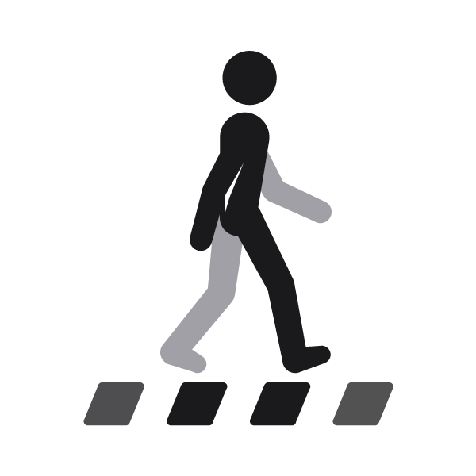

# Walking icon — pedestrian crossing

- [walk-icon.gif](https://github.com/exmunc/walking-icon/raw/main/walk-icon.gif) — 600×600, 50 fps, seamless loop
- [walk-icon.mp4](https://github.com/exmunc/walking-icon/raw/main/walk-icon.mp4) — same, 10 loops

Source: `rig.py` (procedural walk cycle), `icon.py` (renders frames).
